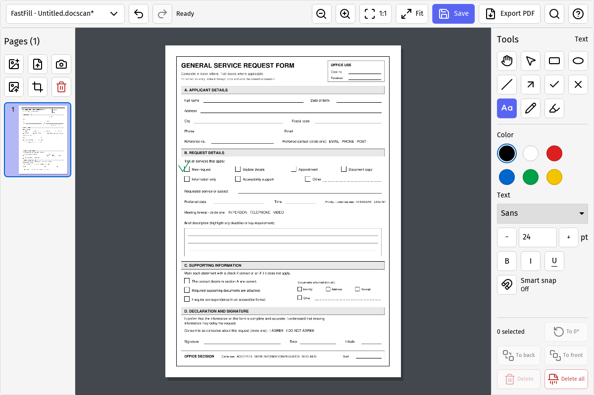
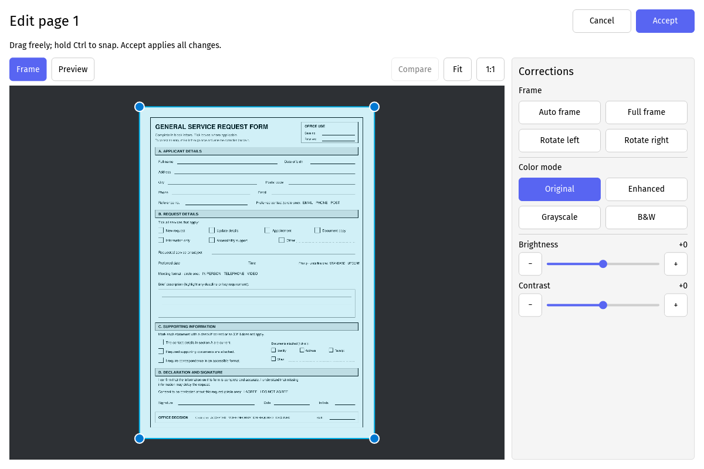
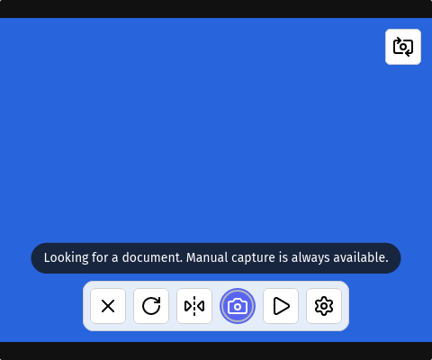

# FastFill user manual

FastFill turns scanned images, PDFs, and camera photos into annotated pages.
Save an editable `.docscan` project; export a PDF when the document is ready to
share. This guide covers the desktop app and browser build. Camera capture is
available in supported Windows and Linux desktop builds, not in the browser.

## Start and organize a project

The desktop window opens maximized; restore or resize it as needed.

Open the project-name menu at top left for **New project** or **Open project**.
Use **Add image** or **Import PDF** in the Pages rail to add pages. **Replace
image** changes the selected page's source; FastFill asks before replacing a
page with annotations. Click a thumbnail to switch pages. Drag a thumbnail to
reorder; drop outside the rail or press Escape to cancel. The page menu also
moves the current page one place earlier or later. **Delete page** asks for
confirmation.

The header holds Undo, Redo, zoom, Save, Export PDF, Commands, and Shortcuts.
**Fit** shows the whole page; **1:1** returns to actual size. On narrow windows,
less-used actions move into **More**. Scroll over the canvas to zoom at the
pointer; right-drag to pan. The Navigate tool pans by mouse drag or one finger;
two fingers pan and pinch to zoom.

## Draw and edit annotations

Choose a tool in the Tools panel: Select, Rectangle, Oval, Line, Arrow, Check,
Cross, Text, Pen, or Highlight. Draw with a drag; click with Text to place its
caret and type. Set color and line width in the panel. Closed shapes can be
filled. Text has font, size, bold, italic, and underline controls. Changing a
property with an annotation selected edits that annotation; without a selection
it sets the next annotation's default. Switching tools clears selection.

With **Select**, click an annotation to select it. Drag a selected annotation or
its visible handles to move or resize it; use the rotation knob where available.
Drag from empty space or an unselected object for a marquee. **Ctrl+click** adds
or removes one object; **Ctrl+drag** forces a new marquee even over a selection.
**Ctrl+A** selects every annotation on the page (Cmd+A on macOS). Escape clears
selection. The panel's To back/To front buttons change layer order; Delete
removes the selection, while Delete all removes every annotation on the current
page. Undo and Redo apply to the active page.

Hold **Ctrl** while drawing or resizing for a square/circle or a 45° line/arrow.
Ctrl+drag on the rotation knob snaps to 45°; **To 0°** resets rotation. Hold
Shift to force move or Alt to force resize when the relevant handles are shown.
Turn on **Smart snap** for form boxes and text lines; it can place marks in
boxes and start or reuse text at a detected line. Detection may also find
decorative lines, so inspect the result before saving.

For text, **Enter** accepts the edit; **Shift+Enter** inserts a line break. Text
does not wrap automatically. Clicking away accepts; **Escape** discards the
pending text and formatting changes. A selected text box is still an ordinary
movable annotation until you enter text editing with the Text tool.

## Correct a page image

Select a page and choose **Edit page** in the rail. **Frame** shows the source
and draggable crop corners. **Auto frame** proposes a document outline; **Full
frame** resets it. Ctrl+drag a corner to snap it to nearby image edges or
corners. Rotate left/right as needed. Choosing a color mode, brightness, or
contrast automatically shows **Preview**, where you can inspect the result at
Fit or 1:1. Hold **Compare** to see the original; release it to return to the
adjusted preview. You can switch Frame and Preview without losing pending
changes. **Accept** applies them; **Cancel** or Escape keeps the old page.

Annotations stay tied to the image when it is cropped, rotated, or scaled.
FastFill warns if an edit would displace annotations. Inspect those placements
after Accept; Undo can restore the prior page state.

## Capture from a camera

On supported Windows/Linux desktop builds, choose **Camera** in the rail. The
live view uses a small floating control dock: Cancel, Rotate, Mirror, Capture,
Pause/Resume, and Settings. A separate corner button switches cameras. Settings
lets you choose the camera and resolution or refresh the device list.
Front-facing cameras are mirrored in the preview by default to help aim the
paper; the image is unmirrored when you choose **Use photo**.

The blue area is a synthetic test frame; a live camera image appears there in
normal use.

Hold the document steady for automatic capture, or press the circular Capture
button yourself. A progress ring and message appear over the image. After
capture, review the photo: **Retake** restarts the preview; **Use photo** sends
it to the page editor for framing and correction. Cancel there cancels the
correction, not the already accepted photo. If preview pauses after sleep or a
camera interruption, use Resume preview; the steadiness countdown starts over.

## Save, export, and recover

**Save** writes an editable `.docscan` project on desktop. Use **Save as** in
the project-name menu to choose a different file. In the browser, Save downloads
a project copy; there is no separate Save as. **Export PDF** creates a document
for sharing, but it is not a substitute for the editable project. Save before
closing or starting another project. Desktop builds keep an unsaved recovery
snapshot and offer to restore it after an interrupted session; still save
explicitly. The browser build does not provide that native recovery feature.

Projects hold at most 20 pages. An image may be at most 50 megapixels, with a
200-megapixel budget across source and corrected page images. If an operation
would exceed a limit, FastFill refuses it without changing the project. Each
page also limits annotations and retained undo history; the oldest undo steps
are discarded when the history budget is full.

## Find commands and shortcuts

Open **Commands** (magnifying glass) or press **Ctrl+.** (Cmd+. on macOS).
Search, use arrow keys to choose a result, then Enter; Escape closes it. Press
**F1** or the **Shortcuts** button for the full mouse, touch, keyboard, and
platform-specific modifier reference. F1 also works while Commands is open. The
browser or operating system may intercept F1; use the button in that case.
